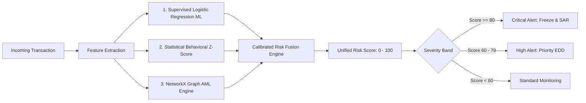

# SentinelGuard | AI Financial Security & AML System

An enterprise-grade, autonomous Financial Crime Detection, Anti-Money Laundering (AML), and Network Topology Intelligence Platform designed for financial institutions, fintech operators, and compliance investigators.

---

## 🛠️ Tech Stack & Tools Used

* **Frontend & Dashboard Interface**: [Streamlit](https://streamlit.io/) with a custom dark-mode cybersecurity design system (`#0E1117` base, `#11141C` surface, electric cyan `#00D4FF` accents, and risk badges).
* **Supervised Machine Learning**: [scikit-learn](https://scikit-learn.org/) (`LogisticRegression`, `StandardScaler`) for non-linear multi-vector fraud probability scoring.
* **Network Topology & Graph Mining**: [NetworkX](https://networkx.org/) for in-memory directed multigraph cycle detection and money mule path traversal.
* **Interactive Data Visualization**: [Plotly Graph Objects & Express](https://plotly.com/python/) (Dual-axis time-series velocity trends, donut risk distributions, and directional Sankey capital flow pathways).
* **Forensic AI Copilot**: Google Gemini Official SDK (`google-genai` / `gemini-2.5-flash` & `gemini-3.5-flash-lite`) for automated Suspicious Activity Report (SAR/STR) drafting, case assessments, and regulatory briefings.
* **Data Engine & Schemas**: [pandas](https://pandas.pydata.org/), [NumPy](https://numpy.org/), and [Pydantic](https://docs.pydantic.dev/) for deterministic data modeling and session persistence.

---

## 📚 Methodology & Explainability

SentinelGuard implements a defense-in-depth, hybrid detection architecture. Rather than relying on a solitary black-box model, each transaction is scored in parallel across three complementary analytical engines before arriving at a unified threat index.

### 1. Multi-Stage Hybrid Detection Architecture



---

### 2. Supervised Machine Learning Engine (scikit-learn)

The supervised machine learning engine evaluates multi-dimensional risk vectors and non-linear interactions across six primary engineered features:

* **`amount`**: Transaction principal in INR ($\text{₹}$).
* **`is_round_amount`**: Binary indicator ($1.0$ if amount is an exact multiple of $\text{₹}500$ or $\text{₹}1,000$ above $\text{₹}1,000$), indicative of manual illicit transfers.
* **`hour_of_day`**: Temporal hour ($0.0 - 23.0$) capturing anomalous nocturnal transfers.
* **`channel_encoded`**: Settlement rail (`UPI`, `Money Transfer`, `Crypto`, `Card Swipe`, `IMPS`, `NEFT`, `Wallet`).
* **`sender_velocity_today`**: Rolling 24-hour transaction frequency originating from the sender entity.
* **`sender_account_age`**: Entity age in days to flag high outflow from nascent accounts.

#### Mathematical Formulation:
Features are standardized using `StandardScaler` ($\mu=0, \sigma=1$). Fraud classification probability is derived via the standard sigmoid activation function:

$$P(\text{Fraud} \mid X) = \frac{1}{1 + e^{-(\beta_0 + \sum \beta_i X_i)}}$$

---

### 3. Statistical Behavioral Z-Score Engine

The behavioral anomaly engine calculates standard deviations against an entity's specific historical baseline:

$$Z = \frac{X - \mu_{\text{hist}}}{\sigma_{\text{hist}}}$$

#### Robust Edge-Case Handling & Statistical Calibration:
* **Insufficient Historical Baseline**: If an account has fewer than 3 historical transactions, $Z$ defaults strictly to $0.00$ to prevent false positives during entity onboarding.
* **Zero Variance ($\sigma = 0$)**: If historical amounts are perfectly uniform and $X > \mu$, $Z$ defaults to $+3.00$; otherwise $0.00$.
* **Statistical Bounding**: Outputs are strictly clamped to $[-5.0, +5.0]\sigma$ to prevent single extreme outliers from skewing downstream risk fusion weights.

---

### 4. Graph Network Topology AML Rules (NetworkX)

SentinelGuard maintains an in-memory directed multigraph $G = (V, E)$ where nodes $V$ represent account entities and directed edges $E$ represent capital transfers with timestamps and volumes.

#### Automated Topological Heuristics:
1. **Structuring / Smurfing (BSA & CTR Evasion)**:
   Detects $\ge 2$ transfers within a 24-hour window where individual amounts sit in the regulatory evasion band ($\text{₹}40,000 - \text{₹}49,999$ beneath the $\text{₹}50,000$ CTR reporting threshold) totaling $\ge \text{₹}95,000$.
2. **Circular Fund Flow Rings**:
   Identifies closed directed loops ($A \to B \to C \to A$) via `nx.simple_cycles(G)` with $\text{length} \ge 3$ to detect artificial layering, tax evasion, and wash circulation.
3. **Fan-Out & Fan-In Bursts**:
   Flags accounts dispersing funds to $\ge 4$ unique counterparties, or aggregating from $\ge 4$ unique sources within 24 hours.
4. **Money Mule Rapid Pass-Through**:
   Flags entities receiving large inbound credits followed by an outbound distribution of $\ge 90\%$ volume within a 30-minute window, especially on accounts $< 90$ days old.

---

### 5. Calibrated Unified Risk Scoring & Fusion Matrix

The unified risk score aggregates independent detection signals into an explainable, deterministic $0 - 100$ index:

$$\text{Risk Score} = \underbrace{40 \times P_{\text{ML}}}_{\text{ML Component (0 - 40 pts)}} + \underbrace{\min\left(\frac{|Z|}{4.0}, 1.0\right) \times 30}_{\text{Behavioral Z-Score (0 - 30 pts)}} + \underbrace{\min\left(\frac{\text{AML Typologies}}{3.0}, 1.0\right) \times 30}_{\text{Graph Rules (0 - 30 pts)}}$$

#### Regulatory Action Severity Matrix:
| Severity Band | Unified Score | Color Code | Mandatory Compliance Protocol |
| :--- | :--- | :--- | :--- |
| **Critical** | $80.0 - 100.0$ | `#FF4444` (Red) | Immediate administrative account freeze, emergency FIU escalation & SAR draft |
| **High** | $60.0 - 79.9$ | `#FF8C00` (Orange) | Priority Tier-2 compliance investigation, step-up KYC verification (EDD) |
| **Medium** | $40.0 - 59.9$ | `#FFD700` (Yellow) | Enhanced automated transaction monitoring and velocity throttling |
| **Low** | $0.0 - 39.9$ | `#00C851` (Green) | Standard processing, auto-cleared |

---

## 💻 Platform Modules

1. **📊 Overview Dashboard**: 6 real-time KPIs, dual-axis volume and mean risk trends, risk score donut distribution, and a highlighted caution-styled *Critical Alert Watchlist*.
2. **⚡ Transaction Monitor**: Multi-parameter filtered ledger supporting UPI, Money Transfer, Crypto, Card Swipe, IMPS, and NEFT, with row-level severity color-coding and deep forensic counterparty inspector.
3. **🕸️ AML Investigation**: Directional Capital Flow Sankey visualizer and filtered Threat Cluster Topology, paired with robust cycle detection and structuring hub forensics.
4. **👤 Account Risk Profiles**: Color-coded entity risk ledger hard-filtered to High and Critical risk accounts, with customer KYC dossiers, flow concentration, and counterparty breakdowns.
5. **🚨 Alerts & Case Management**: Alert triage workspace with deep **Gemini AI Copilot** integration generating executive briefings, regulatory PMLA/FATF implications, and SAR/STR remediation protocols.
6. **🧪 Detection Lab & Simulator**: Live financial crime stress-testing lab with 6 one-click scenarios (Structuring, Circular Rings, Mule Pass-Through, Velocity Bursts) plus custom transaction injector.

---

## 🚀 Quickstart

1. Clone repository and install dependencies:
```bash
pip install -r requirements.txt
```

2. Launch the application:
```bash
streamlit run app.py
```
